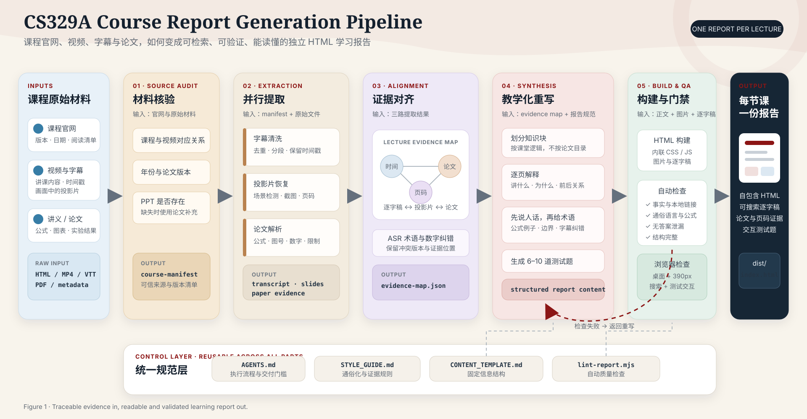

# CS329A Study Reports

将 CS329A 课程视频、逐字稿、投影片和指定论文整理成可检索、可验证、能直接学习的中文 HTML 报告。

> 非 Stanford 官方项目。课程、视频、投影片和论文版权归原作者及权利人。

<p align="center">
  
</p>

## Pipeline

1. 核验课程官网、视频日期、论文版本和讲义状态。
2. 并行处理字幕、投影片和论文证据。
3. 建立“视频时间—投影片页码—论文位置”映射。
4. 按课堂逻辑划分知识块，先解释直觉，再补专业术语。
5. 构建包含图片、逐字稿和测试题的独立 HTML。
6. 检查事实边界、语言可读性、链接、移动端和交互。

## Reports

| Part | Topic | Report |
|---|---|---|
| 2 | Test-Time Compute Scaling | [`reports/part2/dist/index.html`](./reports/part2/dist/index.html) |

直接下载并用浏览器打开 `dist/index.html`。报告不依赖服务器或外部 JavaScript。

## Build

只需要 Node.js 20 或更高版本，无第三方依赖。

```bash
npm run build:part2
npm run lint:part2
npm run privacy
```

完整检查：

```bash
npm test
```

## Repository structure

```text
.
├── docs/                       # README 架构图
├── reports/
│   └── part2/
│       ├── assets/slides/      # 报告使用的投影片截图
│       ├── data/               # 清洗后的逐字稿
│       ├── scripts/            # 单文件 HTML 构建脚本
│       ├── src/                # HTML、CSS 和交互源码
│       └── dist/index.html     # 可直接打开的最终报告
├── standards/                  # 内容模板与写作规范
└── tools/                      # 报告检查与隐私扫描
```

## Writing standard

- 先讲具体动作和例子，再给术语。
- 每个公式解释用途、符号、数字例子、前提和失效条件。
- 每个知识块给出页码、视频时间、前后关系和边界条件。
- 实验结果必须说明模型、任务、版本和比较范围。
- 测试题不在 HTML 或 JavaScript 中保存答案。

完整规则见 [`standards/STYLE_GUIDE.md`](./standards/STYLE_GUIDE.md) 和 [`standards/CONTENT_TEMPLATE.md`](./standards/CONTENT_TEMPLATE.md)。

## Included and excluded data

仓库只保留重建报告所需的清洗后逐字稿、投影片截图和源码。以下内容明确排除：

- 原始课程视频
- 下载的论文 PDF
- YouTube 元数据和原始字幕文件
- 浏览器缓存、Cookie 和认证信息
- 本机绝对路径、用户名和个人邮箱
- `.env`、API Key、访问令牌和私钥

`npm run privacy` 会扫描常见个人路径、邮箱和密钥模式。

## License

项目代码和原创文档采用 [MIT License](./LICENSE)。第三方课程、视频、投影片、论文和商标不包含在该授权中。
